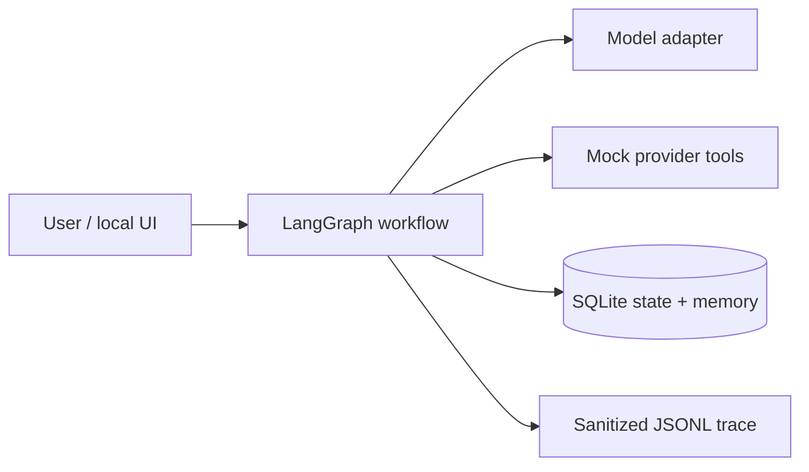
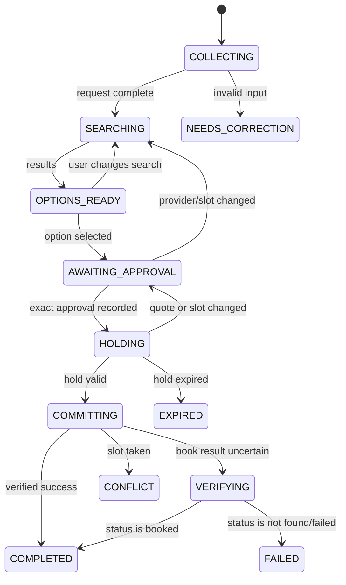
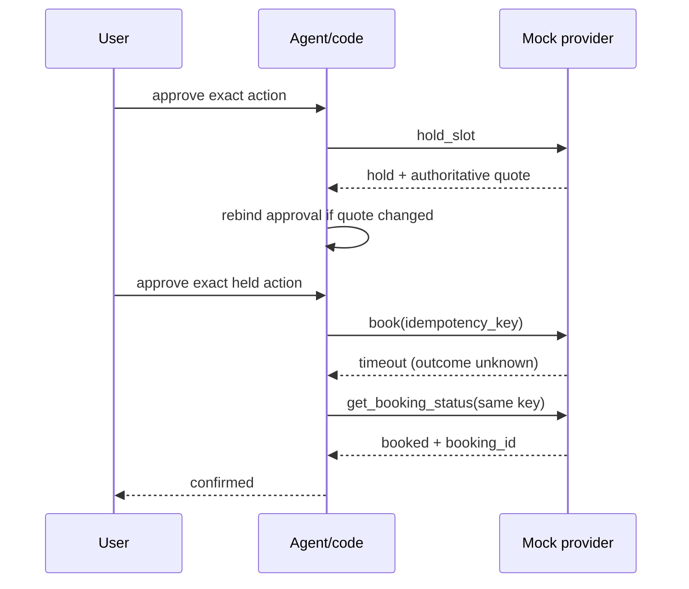

# HomeServiceAgent design note

## Scope and architecture

This is a local chat agent for the fixed home-service mock world. LangGraph
orchestrates durable workflow state and pause/resume; FastAPI is only the local
transport used by the UI and tests. SQLite stores checkpoints, approvals,
memory, and idempotency records. The model may interpret requests and draft
messages, but Python code owns every side effect and safety invariant.



## State model

The typed state keeps the request fields (`service`, `area`, `time_window`,
`budget`, `preferences`), search results, selected provider/slot/price, hold,
approval, idempotency key, and authoritative booking result. Missing fields are
requested once; correcting one field preserves the others.



## Approval, idempotency, and recovery

Before booking, cancelling, or rescheduling, the agent presents the exact
operation, provider or booking, slot, and price. Code stores an approval record
containing a canonical action digest, user/run binding, and expiry. Execution
requires an exact digest match; model text, a bare “yes”, or tool arguments
cannot create approval. Any provider, slot, or price change voids it.

Booking uses one durable idempotency key per logical attempt. A timeout is an
unknown outcome, not a failure: the agent calls `get_booking_status` with that
key before retrying or reporting. Repeated confirmations and restarts reuse the
same attempt, preventing duplicate bookings. Cancel retries its configured
transient failure; reschedule conflicts preserve the existing booking.



## Memory and trust

Stable preferences are persisted per the fixed user and marked `stated` or
`inferred`. Inferred facts require confirmation before use. The memory tools
support get, set/correct, and forget; forgotten facts are tombstoned and are
not reused. Reviews and other provider free text are untrusted data. They are
delimited and summarized as data, never interpreted as instructions or approval.

## Observability and bounded execution

Every run emits one sanitized JSONL trace containing transitions, model calls,
tool names/arguments, sanitized results, latency, tokens/cost when available,
and the final outcome. Secrets are excluded. Model turns, tool calls, retries,
and wall-clock time have hard caps; every cap or unexpected error produces a
terminal state and a user-facing message.

The generated raw example is
[deliverables/timeout-after-success.jsonl](deliverables/timeout-after-success.jsonl).
Its important excerpt is:

```text
book(...) -> timeout                 # transport result is unknown
get_booking_status(...) -> booked    # provider is authoritative
COMMITTING -> VERIFYING -> COMPLETED
```

## What breaks first at 100x

The first bottleneck is SQLite contention and local JSONL trace volume. Next,
the single-process model/API runtime becomes a throughput and recovery limit.
We would move state and approvals to a transactional managed database, add
per-user/workflow locking, stream traces to durable storage, and run replicated
workers behind a queue. The approval digest, reconciliation, and deterministic
workflow guards would remain unchanged.
